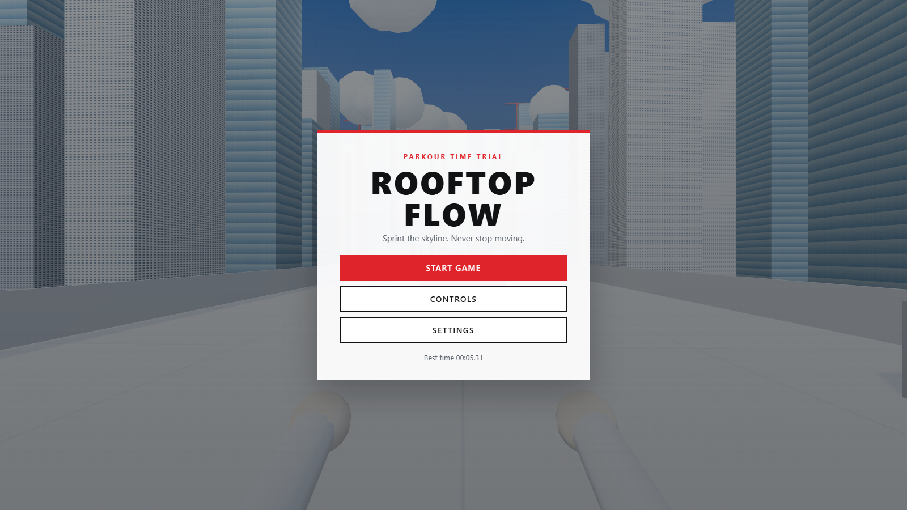
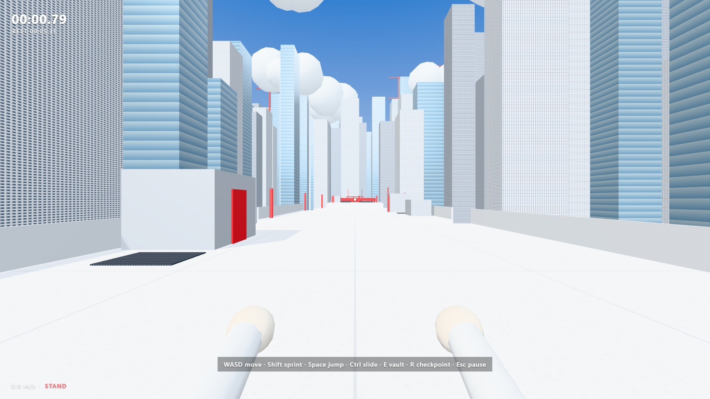
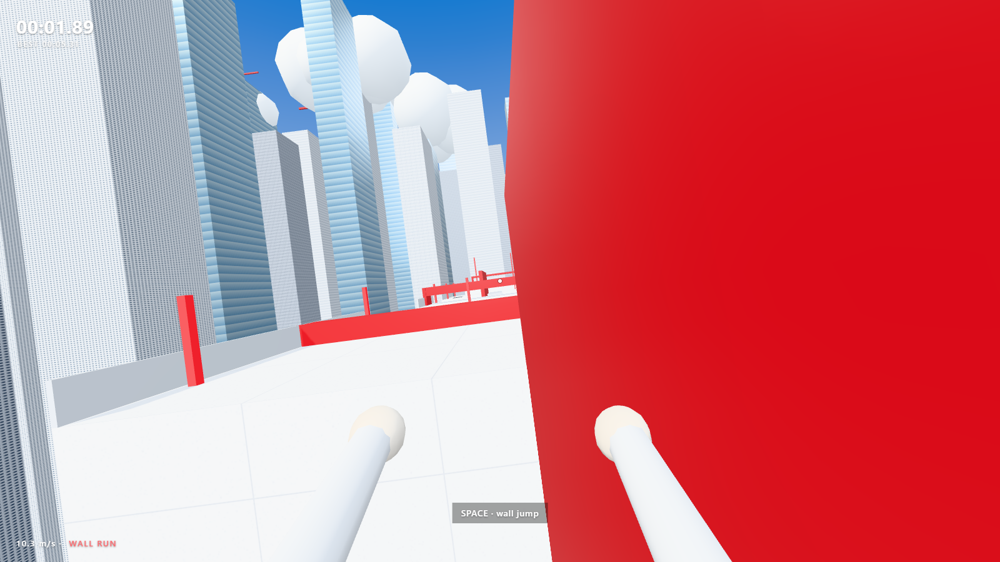

# ROOFTOP FLOW

A first-person parkour time trial built with Three.js, TypeScript and Vite. Run across a bright white rooftop city: sprint, jump, slide, vault, wall-run and mantle through six sections, with checkpoints, a finish arch and a saved best time.

Everything is procedural. There are no external models, textures, audio files or backend.

| Title screen | Gameplay | Wall run |
|---|---|---|
|  |  |  |

## Requirements

- Node.js 20.19+ or 22.12+ (Vite 8 requirement)
- A desktop browser with WebGL 2: Chrome, Edge or Firefox

## Install and run

```bash
npm install
npm run dev
```

Open http://localhost:5173 and press **Start Game**. The game is playable straight after the dev server starts.

Other scripts:

```bash
npm run build     # type-check (tsc --noEmit) and produce a production build in dist/
npm run preview   # serve the production build locally
npm run typecheck # type-check only
```

## Controls

| Key | Action |
|---|---|
| WASD | Move |
| Mouse | Look around (pointer lock). If the browser refuses the lock, hold the left button and drag. |
| Shift | Sprint |
| Space | Jump. Hold for a higher jump. Wall jump while wall running. Jump out of a slide. |
| Ctrl / C | Slide. Sprint first, then slide under low ducts and keep your momentum. |
| E | Vault a low obstacle. Ledges are mantled automatically when you fall into them. |
| R | Restart from the latest checkpoint |
| M | Mute |
| Esc | Pause and unlock the mouse |

Falling off a roof respawns you at the latest checkpoint. The run clock keeps running, so every respawn costs time.

## The route

The route runs from the start towards -Z through six sections, with seven checkpoints:

1. **Movement tutorial**: start roof, a red block to vault, a short 3.6 m gap.
2. **Rooftop jumps**: 4.0 to 4.8 m gaps, a raised roof, red launch markers.
3. **Sliding challenge**: three red ventilation ducts you must slide under, with low vents beside them.
4. **Wall run**: a 9 m gap that a normal jump cannot cross. Run along the red wall on the right.
5. **Combination**: a vault barrier, a narrow bridge, a slide under a duct, then a 6.5 m gap bridged by a red wall on the left.
6. **Final sprint**: four jumps, then the red finish arch.

## Settings and saved data

Settings (mouse sensitivity, reduced camera motion, sound) and the best time are stored in `localStorage` under `rooftop-flow:settings` and `rooftop-flow:best-time`. Clearing site data resets them.

## Project layout

```
src/
  main.ts                    entry point; boots the game
  game/
    Game.ts                  phases, fixed-step loop, respawn, finish flow, pointer lock
    GameState.ts             phase enum, run clock, best-time storage, time formatting
    Settings.ts              persisted player settings
  input/InputManager.ts      held keys, one-shot presses (buffered by the controller), mouse look
  player/
    MovementConfig.ts        every movement tuning value, in one place
    PlayerController.ts      state machine: ground, air, slide, wall run, vault, mantle
    PlayerPhysics.ts         box body, axis-by-axis collision, ground probe
    ParkourSystem.ts         wall-run latching, vault and mantle planning with clear landings
    FirstPersonCamera.ts     look, head bob, landing spring, FOV, tilt, vault dip
    PlayerBody.ts            low-poly arms that sway while sprinting and reach while vaulting
  world/
    CollisionWorld.ts        static boxes used for collision
    LevelLayout.ts           level data: boxes, decor, checkpoints, finish zone
    Level.ts                 turns layout data into merged meshes and collision
    Checkpoints.ts           ordered checkpoint and finish zone detection
    CityGenerator.ts         background skyline, ground, clouds and sky dome (no collision)
    Materials.ts             procedural canvas textures and shared materials
    Geometry.ts              box geometry with texture-scaled UVs, mesh merging, seeded RNG
  ui/
    HUD.ts                   timer, speed readout, checkpoint toast, contextual hints, respawn fade
    Menu.ts                  title, pause, controls, settings and finish screens
  audio/AudioManager.ts      every sound effect synthesised with the Web Audio API
  styles/main.css            menus and HUD styling
```

## Tuning

- Movement feel lives in `src/player/MovementConfig.ts`. Jump apex is about 1.2 m, and a sprint jump covers about 6 m.
- Level geometry and checkpoints live in `src/world/LevelLayout.ts`. Wall-run walls must be longer along Z than along X, so their face normal points along X.
- Simulation runs at a fixed 120 Hz step, so jumps and landings behave the same at any frame rate.
