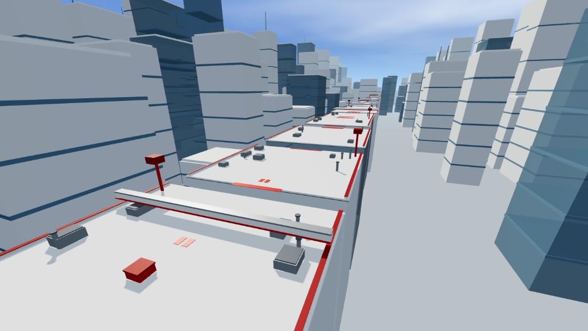

# ROOFTOP FLOW

A fast, first-person rooftop parkour game for the browser, inspired by the movement
feel and visual language of Mirror's Edge. Built with **Three.js**, **TypeScript** and
**Vite** — no game engine, no external assets, no backend.



---

## Quick start

```bash
npm install
npm run dev
```

Then open <http://127.0.0.1:5173/> in a desktop browser (Chrome, Edge or Firefox),
click **START RUN** and click the canvas once to capture the mouse.

```bash
npm run build     # type-check + production bundle into dist/
npm run preview   # serve the production build
```

---

## Controls

| Key | Action |
| --- | --- |
| `W` `A` `S` `D` | Move |
| Mouse | Look around |
| `Shift` | Sprint |
| `Space` | Jump (hold for a higher jump) |
| `Ctrl` / `C` | Slide |
| `E` | Vault / mantle |
| `R` | Restart from the last checkpoint |
| `Esc` | Pause (releases the mouse) |

Settings (mouse sensitivity, camera motion, volume) live in the main menu and are
stored in `localStorage`. Your best completion time is stored as well.

---

## The level

One continuous rooftop route, roughly 530 m long, split into six readable sections:

1. **Movement** — a wide starting roof with a red vault block and an overhead beam
   that can only be passed by sliding. Introduces sprinting, jumping and sliding.
2. **Rooftop jumps** — three rooftops separated by gaps with red take-off markers.
3. **Sliding** — a long elevated ventilation duct you have to slide under.
4. **Wall run** — a 18 m gap with a red wall-run panel; jump at the panel and run it.
5. **Combination** — vault, slide and a second wall run in quick succession.
6. **Final sprint** — a fast run to the red finish gate.

Checkpoints are placed after every major section, falling off respawns you at the
last one, and the red gate at the end triggers the completion screen with your time
and your personal best.

**Red paint is the route.** Take-off strips, vault blocks, wall-run panels, duct
trims, chevrons and the finish gate are all red; the architecture itself stays
white with blue glass towers in the distance.

---

## Movement system

The movement code is the heart of the game and lives in `src/player/`.

* `PlayerController` – the state machine (`normal → slide → wallrun → traversal`),
  input handling, momentum and the parkour triggers.
* `PlayerPhysics` – an AABB body with a fixed-timestep, axis separated collision
  resolution. Movement is subdivided so fast movement can never tunnel through a
  wall or a floor.
* `ParkourSystem` – detection of vault targets, reachable ledges and runnable walls,
  plus the short scripted arc used for vaults and mantles.
* `FirstPersonCamera` – mouse look, head bob, speed based field of view, strafe and
  wall-run roll, landing spring and the vault kick. All of it can be scaled down
  with the *camera motion* setting.

Tuning values live in one place, `src/core/Config.ts`:

| Value | |
| --- | --- |
| walk / sprint speed | 5.6 / 9.6 m/s |
| jump velocity / gravity | 9.4 m/s / 22 m/s² (≈ 2 m high, ≈ 8 m long) |
| coyote time / jump buffer | 0.12 s / 0.15 s |
| slide height | 0.85 m (0.95 m clearance under the ducts) |
| wall-run | max 2.4 s, reduced gravity, jump-off with a push |

A full-speed sprint jump clears about 8 m, which is what the level gaps are built
around (4.5 – 6 m for normal jumps, 18 m for the wall-run gaps).

---

## Project structure

```
src/
  main.ts                 entry point
  core/
    Config.ts             all movement / camera / render tuning
    MathUtil.ts           small maths helpers
  game/
    Game.ts               renderer, scene, game loop, state transitions
    GameState.ts          phase + run timer
    Input.ts              keyboard and pointer lock
  player/
    PlayerController.ts   movement state machine and parkour triggers
    PlayerPhysics.ts      AABB body and collision resolution
    ParkourSystem.ts      vault / ledge / wall detection and traversal arcs
    FirstPersonCamera.ts  camera rig and camera effects
  world/
    Level.ts              the playable rooftop route (geometry + colliders)
    CityGenerator.ts      instanced background skyline
    CollisionWorld.ts     AABB collider store and queries
    Checkpoints.ts        checkpoint triggers
    Sky.ts                gradient sky dome, sun and environment map
  ui/
    HUD.ts                crosshair, timer, notifications
    Menu.ts               main menu, controls, pause and finish screens
  audio/
    AudioManager.ts       Web Audio synthesis (no audio files)
  styles/main.css
```

## Rendering and performance

* One directional sun with a 2048² shadow map that follows the player, a
  hemisphere light and a small ambient light, plus ACES tone mapping.
* All level geometry is merged per material, so the whole rooftop route costs only
  a handful of draw calls. The background skyline uses instanced meshes.
* Pixel ratio is capped at 1.75, the renderer is created with antialiasing and
  `powerPreference: "high-performance"`.
* The sky dome is also used to generate a PMREM environment map for the glass.

## Audio

All sounds are generated with the Web Audio API in `src/audio/AudioManager.ts`:
footsteps, jump, landing, slide, wind that scales with your speed, vault, wall
run, checkpoint and completion chimes. No files are downloaded.
