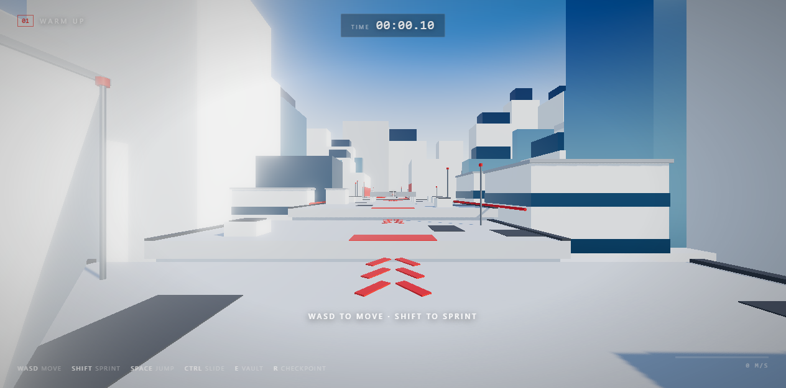

# ROOFTOP FLOW

A fast first-person rooftop parkour game for the browser, inspired by the movement
language of Mirror's Edge. Built with **Three.js**, **TypeScript** and **Vite** — no
game engine, no external art assets, no backend.



---

## Quick start

```bash
npm install
npm run dev
```

Then open the URL Vite prints (default <http://127.0.0.1:5173>). Click **START RUN**,
click the canvas to capture the mouse and you are running.

| Script            | What it does                                             |
| ----------------- | -------------------------------------------------------- |
| `npm run dev`     | Development server with hot reload                        |
| `npm run build`   | Type-check (`tsc --noEmit`) and build a production bundle |
| `npm run preview` | Serve the production build locally                       |
| `npm run typecheck` | Standalone TypeScript check                             |
| `npm run smoke`   | Headless play-through test (needs Chrome + a dev server)  |

---

## Controls

| Key            | Action                                   |
| -------------- | ---------------------------------------- |
| `W A S D`      | Move                                     |
| Mouse          | Look around                              |
| `Shift`        | Sprint                                   |
| `Space`        | Jump — hold longer to jump higher        |
| `Ctrl` / `C`   | Slide (hold to stay low)                 |
| `E`            | Vault a waist-high obstacle              |
| `R`            | Restart from the last checkpoint         |
| `Esc`          | Pause / release the mouse                |

Red paint always marks the route: red crates are vaulted, red beams are slid under,
red walls are wall-run and the red gate is the finish line.

---

## The level

Six hand designed sections, roughly 240 m of continuous rooftop running, 60–120 s for a
clean run.

1. **WARM UP** — a wide roof to learn running, sprinting, jumping, sliding and vaulting.
2. **ROOFTOP LEAPS** — three roofs separated by gaps that need a sprinting jump.
3. **LOW PASS** — a rooftop covered with low beams that must be slid under.
4. **WALL RUN** — a gap that is too wide to jump. Run the red strip, jump and wall run
   along the painted facade to the far roof.
5. **FLOW COMBO** — vault, slide, jump and a second wall run back to back.
6. **FINAL SPRINT** — a fast sequence of jumps to the red finish gate.

Ten checkpoints are placed along the route; falling off the rooftops respawns you at
the last one. The best time is stored in `localStorage`.

---

## Architecture

```
src/
  main.ts                    bootstrap
  game/
    Config.ts                every tuning constant (movement, camera, colours)
    Game.ts                  renderer, loop, phase handling, run timer
    GameState.ts             phase machine, settings and best time (localStorage)
    Input.ts                 keyboard + pointer lock mouse look
  player/
    PlayerController.ts      locomotion, jump rules, coyote time, jump buffering
    PlayerPhysics.ts         AABB collision, sub stepped movement, step up
    ParkourSystem.ts         slide, wall run, vault, ledge recovery state machine
    FirstPersonCamera.ts     head bob, FOV, roll, landing spring, slide height
    ViewModel.ts             low poly arms that react to the movement
  world/
    Level.ts                 the six level sections, props, checkpoints, hints
    LevelRenderer.ts         instanced meshes for the level blocks
    CityGenerator.ts         instanced background skyline
    CollisionWorld.ts        spatial hash + AABB queries and ray casts
    Checkpoints.ts           activation and respawn logic
    Materials.ts             shared material palette and procedural grain
    Sky.ts                   gradient sky dome + environment map
  ui/
    HUD.ts                   crosshair, timer, toasts, hints, speed meter
    Menu.ts                  main menu, controls, pause and finish screens
  audio/
    AudioManager.ts          Web Audio sound effects (no audio files)
  styles/main.css            interface styling
```

### Movement model

* Fixed timestep of **1/120 s** with an accumulator, independent of the frame rate.
* The player is an AABB; horizontal movement is sub stepped so fast runs never tunnel.
* **Variable jump height** – releasing `Space` cuts the rise.
* **Coyote time** (0.12 s) and **jump buffering** (0.16 s) for forgiving inputs.
* Small ledges are stepped over automatically (0.46 m), bigger ones need a vault.
* **Wall running** attaches while airborne next to a tall surface, reduces gravity,
  tilts the camera, and is capped at 1.75 s with a cooldown so it cannot be exploited.
* **Vaulting** is a scripted arc over a waist-high obstacle that keeps the momentum.
* **Ledge recovery** pulls the player up when they fall just below a rooftop edge.

---

## Performance

* The whole level is drawn with a handful of `InstancedMesh` draw calls (one per
  material); the background city is instanced as well.
* One 2048² shadow map that follows the player, plus a directional sun, a hemisphere
  light and a generated environment map for the glass facades.
* Optional bloom (toggleable in the menu), ACES tone mapping and `localStorage`
  settings.
* `npm run smoke` boots the game in headless Chrome, drives a scripted bot through the
  whole route and fails on any console error, missed mechanic or draw-call explosion.

---

## Notes

* All geometry is procedural — no external models, textures or audio files are used.
* The level is an original design inspired by the genre; it contains no assets from
  any commercial game.
* Mouse look requires a user gesture: press **START RUN** and then click the canvas.
* Settings (sensitivity, camera motion, bloom, sound) and the best time live in
  `localStorage` under the `rooftop-flow.*` keys.
