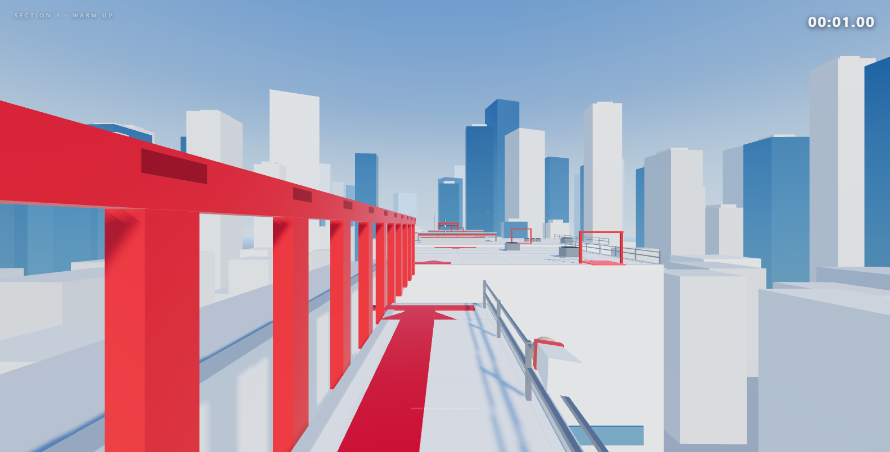

# ROOFTOP FLOW

A fast, first-person rooftop parkour game inspired by the movement and visual
language of Mirror's Edge — built with **Three.js**, **TypeScript** and
**Vite**. Everything is procedural: no external models, textures or audio
assets are required.



---

## Quick start

```bash
npm install
npm run dev
```

Then open <http://127.0.0.1:5321/> and click **START RUN**. The mouse is
locked to the game window; press `Esc` to release it.

Other scripts:

| Script | What it does |
| --- | --- |
| `npm run dev` | Vite dev server with hot reload (port 5321) |
| `npm run build` | Type-check and produce a production bundle in `dist/` |
| `npm run preview` | Serve the production build locally |
| `npm run typecheck` | Type-check only |

---

## Controls

| Key | Action |
| --- | --- |
| `W` `A` `S` `D` | Move |
| Mouse | Look |
| `Shift` | Sprint |
| `Space` | Jump (hold for a higher jump) |
| `Ctrl` / `C` | Slide |
| `E` | Vault |
| `R` | Respawn at the last checkpoint |
| `Esc` | Pause / release the mouse |

---

## Movement model

The controller is a custom AABB character (`src/player/PlayerPhysics.ts`)
running on a **fixed 120 Hz timestep** that is completely independent of the
render frame rate.

* **Momentum.** Acceleration is Quake-style: the velocity component along the
  wish direction is topped up rather than the whole vector being replaced, so
  strafing preserves speed and turning feels instant.
* **Jumping.** Variable height — releasing the button early cuts the rise.
  Coyote time (0.12 s) and a jump buffer (0.14 s) make the timing forgiving.
* **Sliding.** Press `Ctrl` to drop your height to 0.85 m and keep your
  momentum. Sliding preserves speed with low friction, exits with a small
  boost, and can be cancelled at any time by jumping.
* **Wall running.** Airborne and fast next to a red panel, you lock on and run
  along it — gravity is almost cancelled, the camera tilts towards the wall,
  and you can jump off in any direction. Runs are time-limited.
* **Vaulting.** `E` vaults knee-high obstacles while keeping your speed.
* **Ledge recovery.** Falling just short of a ledge lets you mantle back up.

Every mechanic is implemented for real — there are no placeholder behaviours.

---

## The level

One continuous route of nine rooftops strung along the Z axis, designed to be
read from the architecture and the red accents rather than from a minimap.

| Section | Content |
| --- | --- |
| 1 — Warm up | A large plaza with a vault barrier, a slide-through duct and a short gap |
| 2 — Rooftop jumps | Three roofs separated by gaps, with red take-off markers |
| 3 — Sliding | A roof lined with raised ventilation ducts |
| 4 — Wall run | A narrow ledge beside a red wall — the gap ahead is too wide to jump |
| 5 — Combination | Vault → slide → mantle in one flow |
| 6 — Final sprint | Alternating vaults and a duct, then the red finish gate |

Seven checkpoints are placed along the route; falling off a roof respawns you
at the last one. A skilled run takes roughly **60–90 seconds**.

### Runner vision

Red is used deliberately and sparingly, only where it means something:

* red paint on take-off edges and along the wall-run ledge,
* the red wall-run fins,
* red bands on the slide-through ducts,
* red vault barriers and checkpoint arches,
* the red finish gate.

---

## Architecture

```
src/
  main.ts                  bootstrap
  core/Input.ts            keyboard + pointer-lock mouse
  game/Game.ts             renderer, world, player, game loop
  game/GameState.ts        state machine
  player/PlayerPhysics.ts  AABB controller, movement + collision
  player/ParkourSystem.ts  slide, wall run, vault, mantle
  player/FirstPersonCamera.ts  look, bob, FOV, roll, landing dip
  player/PlayerBody.ts     low-poly view model
  world/Level.ts           the playable level
  world/CollisionWorld.ts  AABB world + broadphase grid
  world/CityGenerator.ts   instanced background skyline
  world/Materials.ts       shared palette + materials
  world/MeshBuilder.ts     merges geometry per material
  world/Sky.ts             procedural sky dome + environment map
  ui/HUD.ts                crosshair, timer, toasts
  ui/Menu.ts               menus, settings, best time
  audio/AudioManager.ts    Web Audio sound effects
  styles/main.css          UI styling
```

### Performance

* All level geometry is merged into one mesh per material.
* The background skyline uses two `InstancedMesh` draw calls.
* Shadows use a single 2048² map on a camera that follows the player.
* The pixel ratio is capped at 2.
* The physics runs on a fixed step with a uniform-grid broadphase, so
  collision queries stay cheap regardless of city size.

---

## Sound

All sound effects are synthesised at runtime with the Web Audio API — there
are no audio files to download. Footsteps, jumps, landings, slides, wall runs,
vaults, checkpoint chimes and the completion fanfare are all generated from
noise bursts and oscillators. A wind layer rises with your speed and a
continuous rumble plays while sliding.

---

## Settings

The main menu exposes mouse sensitivity, camera motion intensity and master
volume. Settings and your best time are stored in `localStorage`. Setting
camera motion to `0%` disables head bob, speed FOV, strafe roll and the
landing dip entirely.

---

## Development tools

Two small scripts drive the game in headless Chrome for testing:

```bash
node tools/smoke.mjs    # autopilot run - verifies the level is completable
node tools/shots.mjs    # captures fixed viewpoints into shots/
```

`smoke.mjs` scripts an input sequence, plays through the whole level and
reports the completion time, the furthest point reached and any console
errors. It exits non-zero if the run does not finish.

---

## Browser support

Needs a browser with **WebGL2** and the **Pointer Lock API** — current
Chrome, Firefox, Edge and Safari on the desktop.
