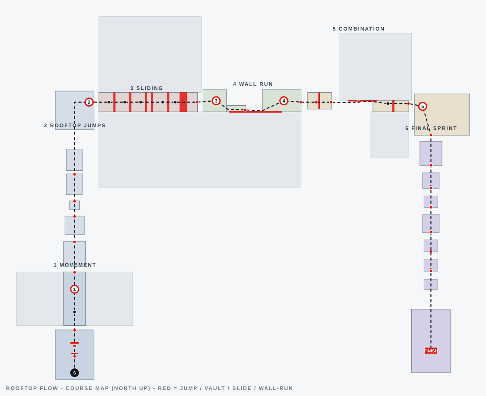
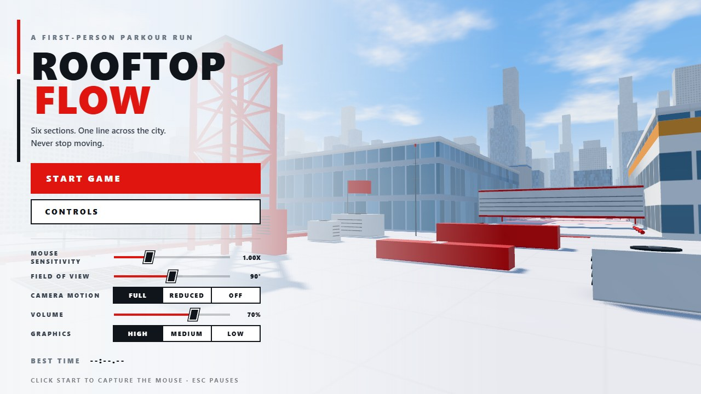
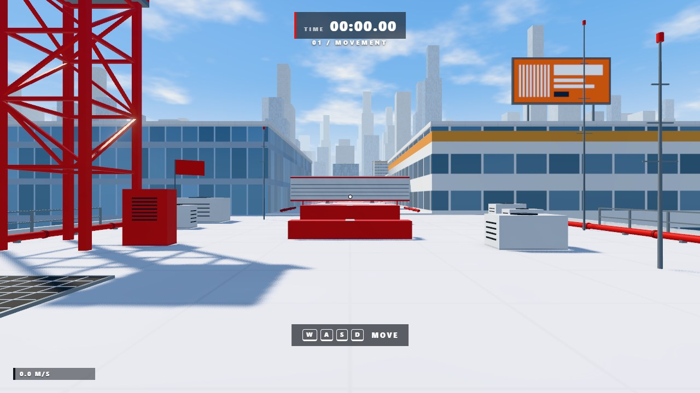
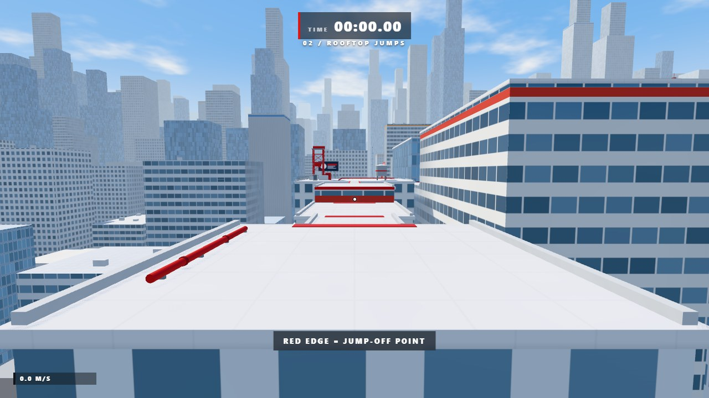
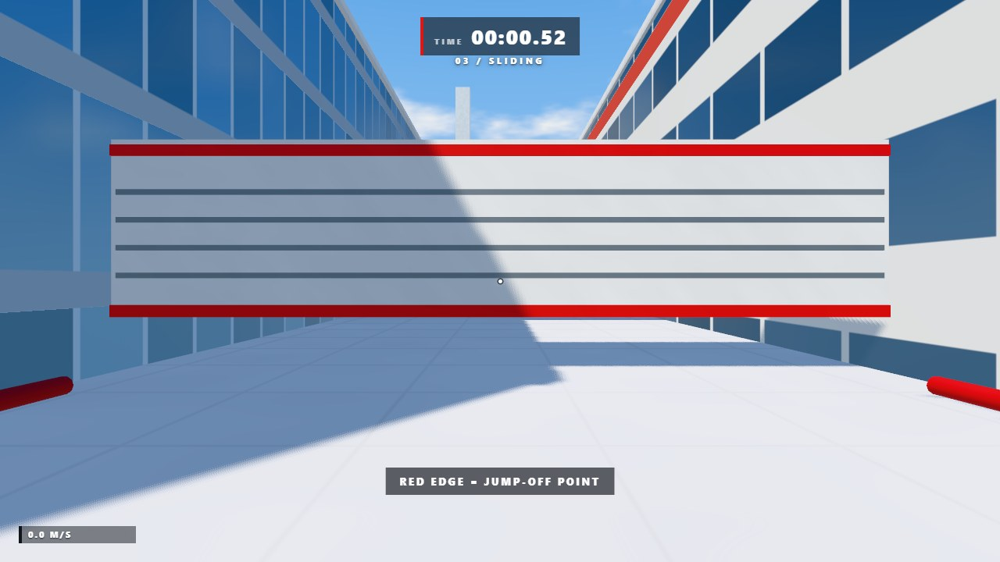
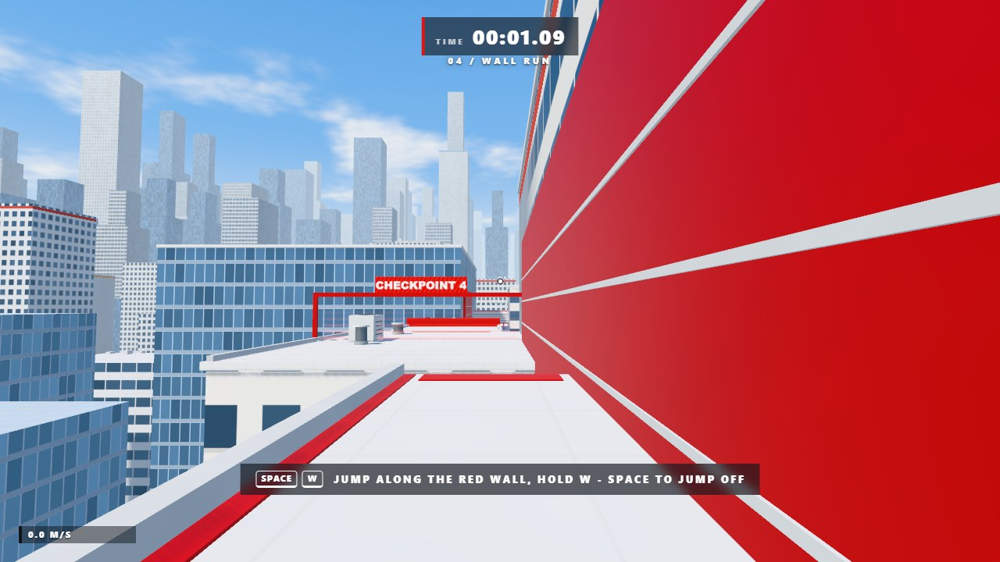
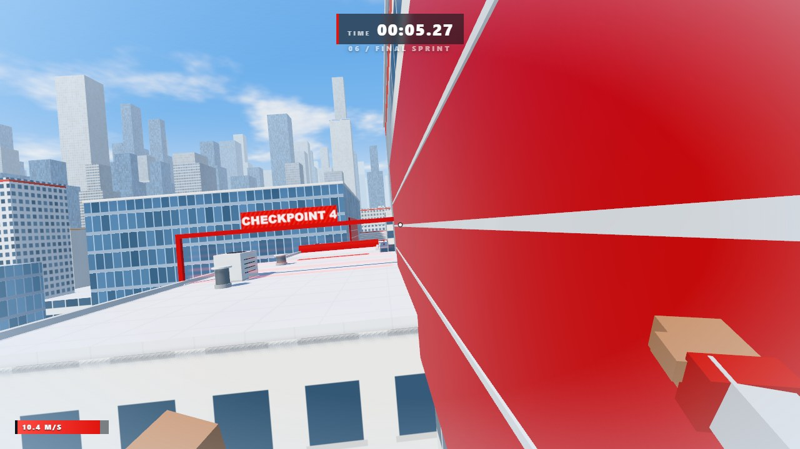
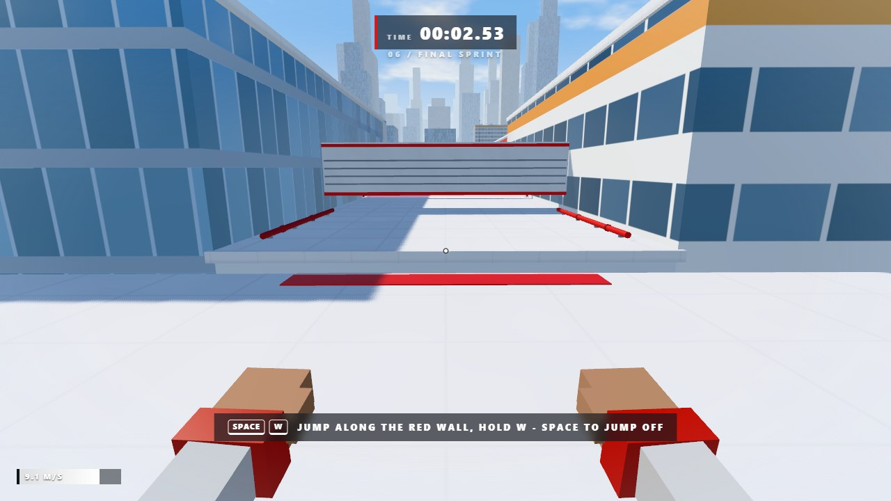
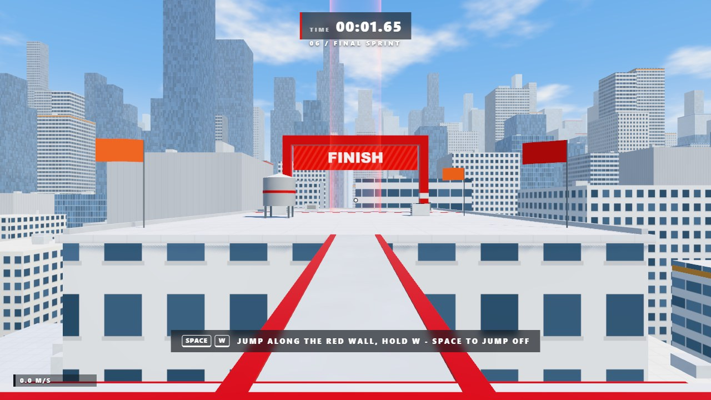

# ROOFTOP FLOW

A first-person rooftop parkour game inspired by the movement, level design and look of *Mirror's Edge*,
built with **Three.js + TypeScript + Vite**. Sprint, jump, slide, vault, climb and wall-run across a
bright, minimalist city of white roofs, red traversal markers and blue glass towers - one complete
six-section course with checkpoints, a timer, a finish line and a locally saved best time.

Everything is original and procedural: geometry, materials, sky, city skyline and every sound effect are
generated at runtime. There are no external models, textures or audio files and no backend.



| | |
| --- | --- |
|  |  |
|  |  |
|  |  |
|  |  |

## Run it

```bash
npm install
npm run dev        # http://localhost:5173
```

Click **Start Game** (the mouse is captured; `Esc` pauses).

| Command | What it does |
| --- | --- |
| `npm run dev` | Vite dev server with hot reload |
| `npm run build` | Type-check (`tsc --noEmit`) and build `dist/` (all URLs are relative, host it anywhere) |
| `npm run preview` | Serve the production build on http://localhost:4173 |
| `npm run test:all` | Type-check + movement tests + full-course bot + physics fuzz test (needs Node 22.18+) |

Requires Node 20.19+ (22.18+ for the Node-side test tools) and a desktop browser with WebGL2
(Chrome, Edge, Firefox).

## Controls

| Key | Action |
| --- | --- |
| `W` `A` `S` `D` | Move |
| Mouse | Look |
| `Shift` | Sprint (hold). Top speed *builds* the longer you keep moving without stopping |
| `Space` | Jump (hold for height) - also jumps off a wall run and pulls you up a ledge |
| `C` / `Ctrl` | Slide while sprinting; slide under low ducts; press as you land to roll out of a fall |
| `E` | Vault low obstacles / climb a ledge (buffered: press a little early) |
| `R` | Restart from the last checkpoint |
| `Esc` | Pause / release the mouse |

> `Ctrl+W` closes a browser tab, so use **C** for sliding.

Settings (main menu and pause menu, saved in `localStorage`): mouse sensitivity, field of view,
**camera motion** (Full / Reduced / Off - scales head bob, roll, FOV kick, landing impacts and vault
animation; defaults to Reduced when the OS asks for reduced motion), volume and graphics quality.
Quality also adapts automatically: if the frame time stays high the game steps down High -> Medium -> Low.

## The course (60-120 s)

Red marks the way (Runner Vision): jump-off edges, vault boxes, slide slots, the climbable ledge and every
wall-run surface are red - the rest of the route stays readable through architecture and placement.

1. **Movement** - big start roof: run, sprint, jump a low crate, vault a taller one, short gap, then slide
   under a ventilation bulkhead. *Checkpoint 1.*
2. **Rooftop jumps** - gaps of 4-5 m with height changes, a stepping-stone pillar, a climbable ledge
   (miss it by a little and you grab the edge and mantle), a narrow steel bridge. *Checkpoint 2.*
3. **Sliding** - a canyon between two towers with six ventilation bulkheads, a double and a long low
   tunnel. Slide, keep your speed, stand up between them. *Checkpoint 3.*
4. **Wall run** - a 12 m gap that can **not** be jumped; run along the red wall. *Checkpoint 4.*
5. **Combination** - vault the wall, jump, bridge, wall run on the *left* wall, land and slide under a
   bulkhead, jump to the plaza. *Checkpoint 5.*
6. **Final sprint** - seven roofs, a climb and a long momentum jump down to the finish gate and its red
   beacon. Crossing the line shows **LEVEL COMPLETE**, your time, your best time and a Restart button.

Falling off any roof respawns you at the latest checkpoint (the timer keeps running). The run clock starts on
your first movement.

A fast but clean run takes about 62 s at full momentum, 74 s at base sprint speed, typically 80-120 s for a
first successful run.

## Movement model

All movement runs in a **fixed 120 Hz simulation** (`FIXED_DT`), independent of the frame rate; the camera
renders the interpolated state. Key numbers (`src/config.ts`):

- walk 5.4 m/s, sprint 9.0 m/s, up to 10.6 m/s with the momentum ("flow") bonus; speed cap 12.5 m/s
- ground acceleration 17 m/s^2 with a strong lateral grip (crisp turns), stopping in ~0.4 s
- gravity 28 m/s^2 (x1.18 while falling), jump 8.6 m/s (1.28 m apex, ~5.3 m long at sprint speed),
  variable height when the key is released early, 0.11 s coyote time, 0.13 s jump buffer
- slide: 0.9 m collision box, +6% speed boost on entry, 4.4 m/s^2 friction, steerable, jump out of it, stand up
  only when there is headroom (a low tunnel can never trap you - you carry on as a crouch-walk)
- wall run: needs a red wall panel, forward input and >= 5 m/s; low gravity that ramps up, max 2.3 s per wall
  and 3.4 s / 3 attaches per airtime, cooldown on the same wall; camera rolls toward the wall; `Space` kicks off
- vault: obstacles 0.42-1.4 m high and up to 2.6 m deep; below 0.82 m, sprinting into it hops it automatically
- mantle / ledge recovery: ledges 0.35-2 m above your feet are grabbed automatically when you fall toward them
  holding `W` (or on `E` / `Space`); a pre-validated, collision-free curve moves you up and over

Collision is a spatial-hash of axis-aligned boxes with swept, axis-separated resolution in sub-steps no longer
than 0.18 m (thinner than any collider), auto step-up of small curbs, ground snapping and a last-resort
depenetration safety net. Vaults and mantles follow validated curves so they cannot clip.

## Architecture

```
src/
  main.ts                    entry: boots the Game, handles WebGL failure
  config.ts                  every movement / camera tuning value
  game/
    Game.ts                  owns all subsystems, fixed-step loop, menus/pause/respawn flow, hints, governor
    GameState.ts             phases, run state (timer, falls), best-time storage, time formatting
    Settings.ts              persisted user settings
    Events.ts                tiny typed event emitter (gameplay -> audio / camera / HUD)
  input/Input.ts             keyboard + Pointer Lock (drag fallback), edge-triggered presses
  player/
    PlayerPhysics.ts         PlayerBody: swept AABB collision, step-up, ground detection
    ParkourSystem.ts         wall probe, ledge / vault / mantle planning and validation
    PlayerController.ts      state machine: ground / air / slide / wall run / scripted, flow, events
    FirstPersonCamera.ts     mouse look + bob, landing spring, FOV, roll, vault / mantle animation
    PlayerBody.ts            low-poly arms + legs (two-bone IK) in a depth-cleared view-model pass
  world/
    CollisionWorld.ts        spatial-hash AABB world, raycasts
    LevelBuilder.ts          frame-based DSL: roofs, towers, beams, bulkheads, wall panels, clutter
    LevelLayout.ts           the course itself (pure data: boxes, route nodes, checkpoints, hints)
    Level.ts                 collision world + batched meshes + contact shadows + flags + billboards
    GeometryBatcher.ts       merges boxes/cylinders per section x material (few draw calls)
    Materials.ts             procedural facade / roof / noise shader patches on MeshStandardMaterial
    CityGenerator.ts         instanced skyline, rooftop clutter, cranes, street-grid ground
    Sky.ts                   gradient + cumulus sky dome, PMREM environment, sun / haze constants
    Checkpoints.ts           checkpoint gates, finish gate, beacon, trigger logic
  render/RenderPipeline.ts   renderer, cascaded sun shadows, MSAA HDR composer, bloom, quality presets
  audio/AudioManager.ts      Web Audio synthesis: steps, jump, land, slide, wind, chimes, finish jingle
  ui/HUD.ts, ui/Menu.ts      DOM overlays (markup in index.html, styling in styles/main.css)
  debug/Autopilot.ts         route-following bot used by the test tools (and `?debug`)
tools/                       sim / route bot / fuzz / jump table / level map / browser tests (see below)
```

Rendering notes: a two-cascade `SunLight` shadow, hemisphere + baked-sky image-based light, exponential
haze matched to the sky horizon, Khronos neutral tone mapping and a light bloom. The level is merged into
~200-300 draw calls per frame (shadow cascades and post passes included) and ~60-75k triangles; the background
city is instanced. Measured GPU time is about 1 ms per frame at 1080p on a desktop RTX card.

## Verification

The level was not just eyeballed - it is proved playable by replaying it through the real controller.

```bash
node tools/sim.mjs                 # 39 movement checks: gravity, tunnelling, slide, vault, mantle, wall run,
                                   #   coyote / jump buffer, frame-rate independence, landing friction
node tools/jump-table.mjs          # centre travel per take-off speed / landing height (gap design data)
node tools/route-bot.mjs           # autopilot completes the whole course (62 s) + stress test with human error
node tools/route-bot.mjs --noflow  # same without the momentum bonus (base 9 m/s sprint): 74 s
node tools/route-bot.mjs --margins # per-jump "how early can I jump and still make it" (ledge grab disabled)
node tools/fuzz.mjs 600 40         # random-input fuzz on the real level: no NaNs, no body-in-geometry
node tools/level-map.mjs           # regenerates docs/level-map.svg
```

Browser tools (need `playwright` and Chrome; set `PLAYWRIGHT_FROM` to a `package.json` whose
`node_modules` has it if it is not installed here):

```bash
node tools/browser-check.mjs http://localhost:5173/?debug tools/out autopilot  # real run to the finish screen
node tools/ui-flow.mjs                                                           # menu / pause / respawn flow
node tools/shots.mjs tools/specs/tour1.json tools/out                            # screenshots from fixed vantage points
node tools/capture-docs.mjs                                                      # regenerates docs/screenshots
node tools/perf.mjs http://localhost:5173/?debug 10 1920 1080 high               # GPU timing + draw calls
```

Open the game with `?debug` to get `window.__rooftop` (state, teleport to a checkpoint, free camera,
slow-motion, autopilot, lighting tuning).

## Credits

All code, geometry, shaders and sounds are original. The look is inspired by the white-and-red rooftop
aesthetic of *Mirror's Edge*; no assets from that game are used.
