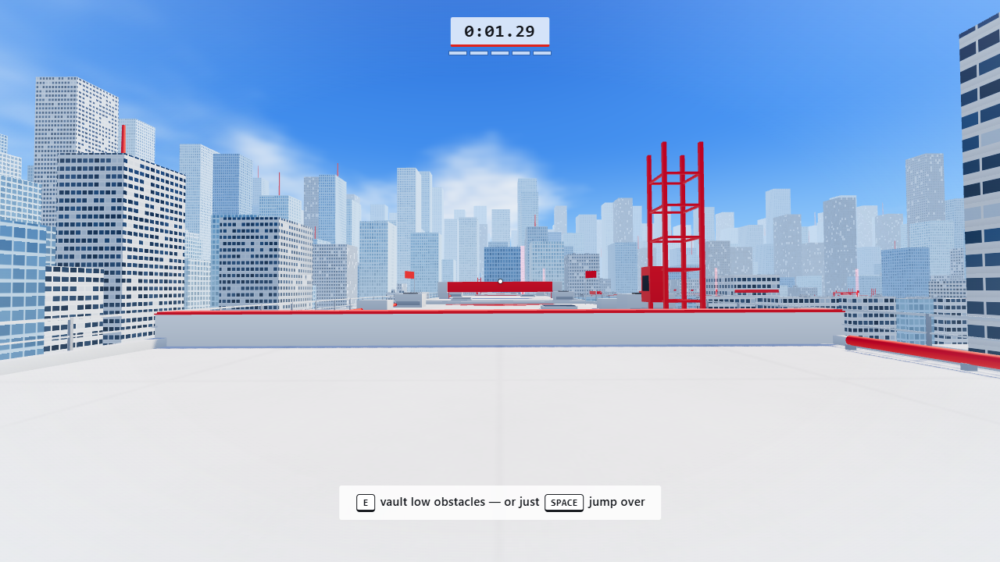
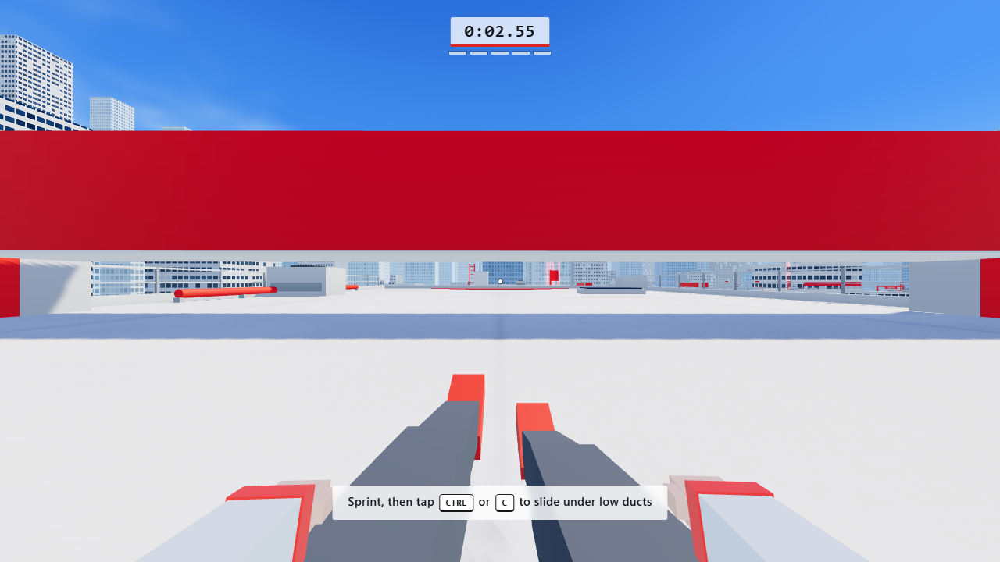
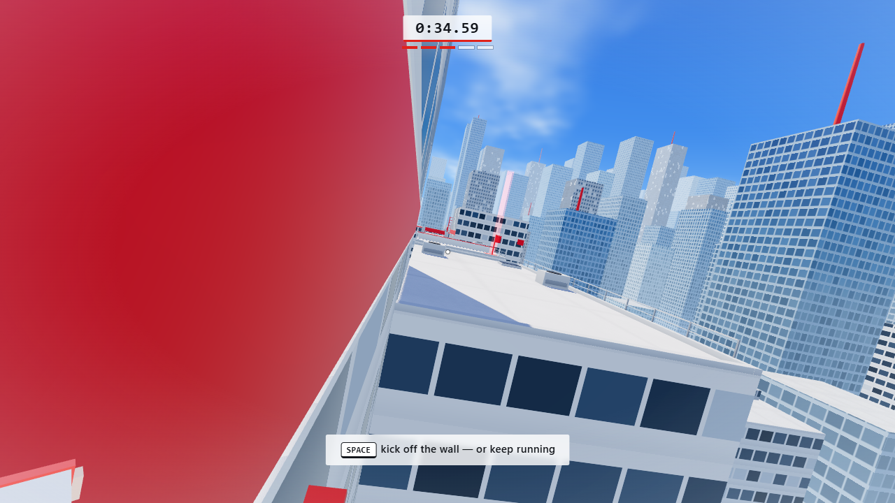
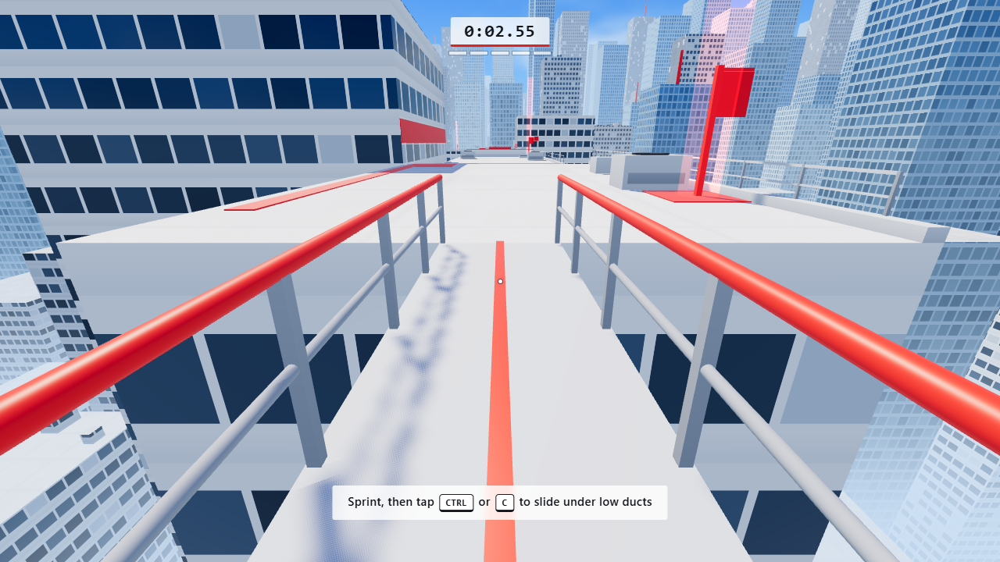

# ROOFTOP FLOW

A first-person rooftop parkour game for the browser, inspired by the movement and the
white-and-red look of *Mirror's Edge*. Sprint, slide, vault and wall-run across a bright
minimalist city in the sky: six sections, 16 jumps, two wall runs, a catwalk bridge, checkpoints, a finish
line and a locally saved best time.

Built with **Three.js + TypeScript + Vite**. No textures, models or audio files are
downloaded: all geometry, materials and sounds are generated procedurally at runtime.

| | |
|---|---|
|  |  |
|  |  |

## Run it

```bash
npm install
npm run dev
```

Then open the printed URL (default <http://localhost:5173>) in a desktop browser
(Chrome, Edge or Firefox with WebGL 2) and click **Start Game**.

Other scripts:

| Command | What it does |
|---|---|
| `npm run dev` | Vite dev server with hot reload |
| `npm run build` | Type-check (`tsc --noEmit`) and create a production build in `dist/` |
| `npm run preview` | Serve the production build locally |
| `npm run typecheck` | Type-check only |
| `npm run verify` | Headless level verification (see below) |

Requires Node.js 18 or newer.

## Controls

| Key | Action |
|---|---|
| `W` `A` `S` `D` | Move |
| Mouse | Look around (pointer lock) |
| `Shift` | Sprint |
| `Space` | Jump (hold for full height, release early for a short hop) |
| `Ctrl` / `C` | Slide (while sprinting) |
| `E` | Vault low obstacles / pull up onto ledges |
| `R` | Restart from the last checkpoint |
| `Esc` | Pause / release the mouse |

> `Ctrl+W` closes a browser tab, so `C` is provided as an alternative slide key.

Extra moves that need no key of their own:

* **Wall run** - jump along a **red wall** at speed and keep holding `W`. `Space` kicks you
  off the wall; `Ctrl`/`C` drops you. Wall running time is limited and refills only on the ground.
* **Ledge recovery** - if you land just below a rooftop edge, keep holding `W` and you pull yourself up.
* **Landing roll** - hold `Ctrl`/`C` as you land at speed and you roll straight into a slide, keeping your momentum.
* **Jump out of a slide** for a long, fast jump.

Settings (main menu and pause menu, saved in `localStorage`): mouse sensitivity, volume and
**Reduce camera motion** (damps head bob, roll, FOV kick and landing impact).

URL switches: `?debug` shows a debug overlay (FPS, draw calls, state) and `?nolock` uses
drag-to-look instead of pointer lock (handy inside embedded browsers). The overlay can also be
toggled with `` ` `` or `F3`. If the browser refuses pointer lock twice the game falls back to
drag-to-look automatically.

## The level

One continuous route (about 600 m, 60-120 s for a clean run):

1. **Movement tutorial** - a large start roof: sprint, a low red wall to vault, a short gap, a red duct to slide under.
2. **Rooftop jumps** - five roofs at different heights with gaps of 5-7 m, red take-off markers, one roof two metres higher (ledge recovery) and a big turn roof.
3. **Sliding challenge** - a long glass-office roof with three low red ducts and a pipe bar, ending in a narrow catwalk bridge.
4. **Wall run** - a 12.5 m gap that a normal jump cannot cross, beside a tall tower with a red wall band.
5. **Parkour combination** - vault, jump, a second wall run (on the right-hand side), an immediate slide, a mantle and a turn.
6. **Final sprint** - four jumps in a row to the red finish gate.

Checkpoints are placed at the start of sections 2-6. Falling below the roofs respawns you at the
last checkpoint (velocity and movement state are reset, the clock keeps running). The run timer
starts with your first movement; the finish screen shows your time and best time.

Red is used on purpose: take-off strips, vault walls, ducts, pipes, wall-run bands, ledge
edges, doors, pylons, checkpoint masts and the finish gate. The rest is white concrete, blue
glass and sky.

## How it works

```
src/
  main.ts                 entry point
  game/
    Game.ts               renderer, scene, main loop, game flow (menu -> run -> pause -> finish)
    GameState.ts          phase + run clock
    Input.ts              keyboard + pointer lock (drag-look fallback), latched key edges
    Settings.ts           persisted settings and best time
  player/
    MovementConfig.ts     every movement tunable in one place
    PlayerPhysics.ts      AABB body, swept axis-by-axis collision, step-up, depenetration
    PlayerController.ts   movement state machine (ground/air/slide/wallrun/vault/mantle)
    ParkourSystem.ts      wall-run detection + steering, vault & mantle planning/execution
    FirstPersonCamera.ts  mouse look, bob, roll, wall-run tilt, speed FOV, landing/vault animation
    PlayerBody.ts         view-model arms (own render pass) and world-space legs / shadow proxy
  world/
    LevelSpec.ts          the level as pure data, authored with a small "turtle" builder
    Level.ts              builds batched meshes + the collision world from the spec
    CollisionWorld.ts     AABB world with a grid broadphase and raycasts
    CityGenerator.ts      instanced background skyline
    Materials.ts          procedural arch / glass / prop / red materials (shader patches)
    Sky.ts                procedural sky dome + PMREM environment for reflections
    Checkpoints.ts        checkpoint logic and markers
    buildWorld.ts         shared spec -> CollisionWorld
  ui/HUD.ts, ui/Menu.ts   DOM HUD, menus, pause and finish screens
  audio/AudioManager.ts   Web Audio synthesis (footsteps, wind, slide, jumps, chimes...)
  styles/main.css
scripts/verify-level.ts   headless verifier (below)
```

**Fixed time step.** Physics runs at 120 Hz independent of the render rate; the camera, arms
and legs are interpolated between the last two physics states, so jumps, landings and speed
are identical at 30, 60 or 240 fps. Collision moves are split into sub-steps shorter than
the player's width, so even at 50 m/s falls nothing is tunnelled through.

**Collision.** Everything solid is an axis-aligned box. The player is an AABB resolved one axis
at a time, with a 0.32 m automatic step-up for curbs and rooftop lips, ground probing for
reliable grounded state and a depenetration safety net. Slides shrink the body to 0.9 m, never
stand up without headroom and keep a minimum crawl speed under low ducts, so you cannot get
stuck. Vaults and mantles are short scripted moves along paths that are validated against the
geometry first, and that only pass over an obstacle once the body has been lifted above it.

**Movement feel.** Velocity-based ground control (fast acceleration, momentum preserved above top
speed and bled off gradually, controlled friction on landing), limited air steering that never
adds speed, variable jump height, coyote time (0.11 s), jump / slide / interact buffering,
speed-dependent FOV, strafe roll, wall-run tilt and subtle landing/vault camera animation.

**Rendering.** ACES tone mapping, sRGB output, a directional sun with a 2048 PCF shadow map
that follows the player (texel-snapped to avoid shimmering), hemisphere light plus an
image-based environment generated from the sky shader, exponential distance fog and a height haze
that dissolves facades into the street far below. Level geometry is merged into a handful of
draw calls (a few dozen per frame including the shadow pass), the city (about 1800 blocks) is three instanced
meshes, and the render resolution adapts automatically to hold the frame rate. Arms are drawn in a
separate depth-cleared pass so they can never clip into a wall or block the view.

## Verifying the level

`npm run verify` replays the level's annotated route through the *real* controller and physics
at the game's fixed time step, headless, and reports:

* whether the whole level can be completed (it is: about 65 s),
* that the wall-run gaps are impossible without wall running,
* for every jump, how many metres early or late the jump key can be pressed and still succeed,
* a collision fuzz test: hundreds of random-input runs from every checkpoint that must never
  end up inside geometry, produce NaNs or exceed a sane speed (`--fuzz=600` for more runs).

Tweak `src/player/MovementConfig.ts` or the level in `src/world/LevelSpec.ts` and re-run it to
make sure the level is still fair.

## Troubleshooting

* **Black screen / error message** - WebGL 2 must be enabled (turn on hardware acceleration).
* **Mouse does not capture** - browsers refuse pointer lock for about a second after `Esc`; click
  *Resume* again. Embedded previews may block it entirely, in which case the game switches to drag-to-look.
* **Choppy on a weak GPU** - the game lowers its render resolution automatically; closing other
  GPU-heavy tabs also helps.
